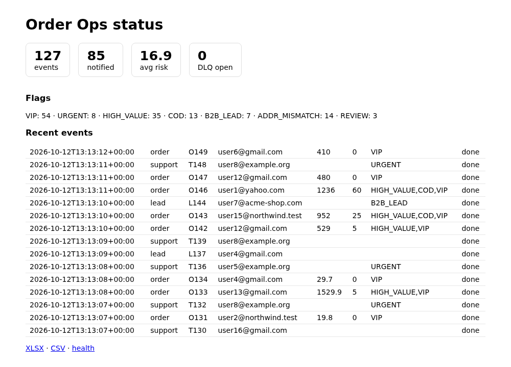
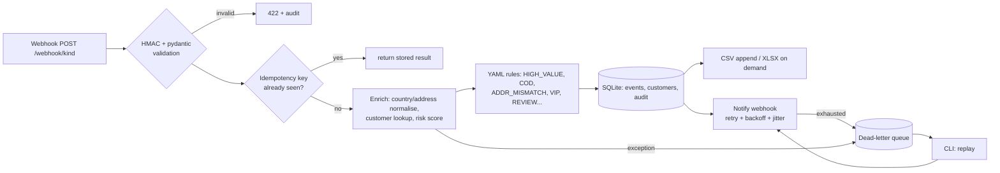

# Order Ops Automation


> **Idempotent, retrying, replayable webhook automation for a small online store: orders, leads and support tickets in, flagged and audited, Slack/Discord alerts out.**



Real `./demo.sh` excerpt (webhook 70% flaky, then recovered): 23 notifications dead-lettered, none lost:
```
open dead letters: 23
$ python -m opsauto.cli replay
{"resolved": 23, "failed": 0}
open dead letters: 0
```

Webhook-driven back-office automation for a small online store: orders, leads and support tickets come in,
get **validated → enriched → run through YAML business rules → stored in SQLite + exported to CSV/XLSX → announced
to Slack/Discord**, with every step audited. Built to show *reliability* patterns, not just happy-path glue.
All data is synthetic; no real services or secrets are needed.



## Reliability features
| Concern | Implementation |
|---|---|
| Duplicate deliveries | `Idempotency-Key` header (or natural key `kind:ref`), atomic `INSERT OR IGNORE` claim; duplicates return the stored result and cause no side effects |
| Flaky downstream | Notifier retries network errors / 429 / 5xx with exponential backoff + jitter; other 4xx fail fast |
| Nothing lost | Failures at `process`, `export` or `notify` stage are parked in `dead_letters`; `python -m opsauto.cli replay` re-drives them (idempotent per stage) |
| Observability | JSON structured logs, `/health` (db + DLQ depth), `/api/stats`, dashboard at `/`, append-only `audit` table |
| Config-driven | `config/rules.yaml` (rules, risk weights, VIP thresholds, retry policy) validated by pydantic at startup |
| Auth | Optional `X-Signature` HMAC-SHA256 when `OPS_WEBHOOK_SECRET` is set |

## Run it
```bash
pip install -r requirements.txt
python -m tools.mock_webhook &                                   # fake Slack/Discord on :9000
uvicorn opsauto.app:app_factory --factory --port 8000 &          # API + dashboard
python -m tools.simulate -n 200                                  # synthetic traffic
open http://localhost:8000      # dashboard; /export.xlsx, /export.csv, /health
python -m opsauto.cli dlq | replay [--id N] | audit
python -m pytest -q
```
Env: `OPS_WEBHOOK_URL` (real Slack/Discord URL; default is the mock), `OPS_WEBHOOK_FORMAT=slack|discord`,
`OPS_DB`, `OPS_EXPORT_CSV`, `OPS_RULES`, `OPS_WEBHOOK_SECRET`, `FAIL_RATE` (mock). Never commit URLs/secrets; `.env` and `data/` are git-ignored.

Example:
```bash
curl -XPOST localhost:8000/webhook/order -H 'Idempotency-Key: demo-1' -d '{"order_id":"A1","email":"x@acme.test",
 "payment_method":"cod","items":[{"sku":"S","qty":1,"price":600}],
 "billing":{"line1":"1 Main","city":"austin","country":"USA"},"shipping":{"line1":"1 Main","city":"lagos","country":"Nigeria"}}'
# -> {"status":"done","risk":100,"flags":["HIGH_VALUE","COD","ADDR_MISMATCH","REVIEW"],"notified":true,...}
```

## Demo (`./demo.sh`, ~45 s)
Starts a 70%-flaky mock webhook, sends traffic, shows the dead-letter queue, "recovers" the webhook and replays
(`SHOT=docs/dashboard.png ./demo.sh` also re-takes the screenshot; needs `pip install playwright && playwright install chromium`). Real output:
```
== 1. traffic while the webhook is 70% flaky
{"ok": 127, "duplicate": 16, "rejected": 7, "failed": 0}
== 2. health
{"status":"ok","dlq_open":23,"uptime_s":37}
== 3. dead-letter queue
#1 notify   sim-order-4 attempts=4 err=HTTP 503
#2 notify   sim-order-23 attempts=4 err=HTTP 503
#3 notify   sim-order-25 attempts=4 err=HTTP 503
#4 notify   sim-order-26 attempts=4 err=HTTP 503
#5 notify   sim-order-29 attempts=4 err=HTTP 503
open dead letters: 23
== 4. replay
{"resolved": 23, "failed": 0}
== 5. dlq after replay
open dead letters: 0
```

## Results
`python -m tools.simulate --inprocess -n 300 --seed 7` (webhook failing 60% of calls, 4 attempts each; also run in CI):
```
traffic   {"ok": 256, "duplicate": 33, "rejected": 11, "failed": 0}
flags     HIGH_VALUE 74, VIP 104, ADDR_MISMATCH 25, COD 19, URGENT 20, B2B_LEAD 16, REVIEW 6
notified  147 | dead-lettered: 28
replay    {"resolved": 28, "failed": 0} | dlq_open now: 0
```
All 33 client retries were de-duplicated, 11 malformed payloads rejected, and every dead-lettered notification was
delivered after replay. 10 pytest tests cover rules, normalisation, idempotency, retry, DLQ/replay, HMAC, health.

## Limitations
- Synthetic data and a toy risk model (weights/country list are demo values, not fraud advice). VIP counts are high because the simulator reuses few customers.
- SQLite + in-process threadpool: fine for a small shop, not horizontally scalable; processing is synchronous per request (retries block that request's worker thread).
- Retries are in-request; a process crash mid-flight leaves an event in `processing` (no reaper yet). The DLQ is a table, not a broker, and replay is manual.
- Customer "lookup" is the local `customers` table; no CRM/shop-API integration, no address geocoding, dashboard has no auth.
